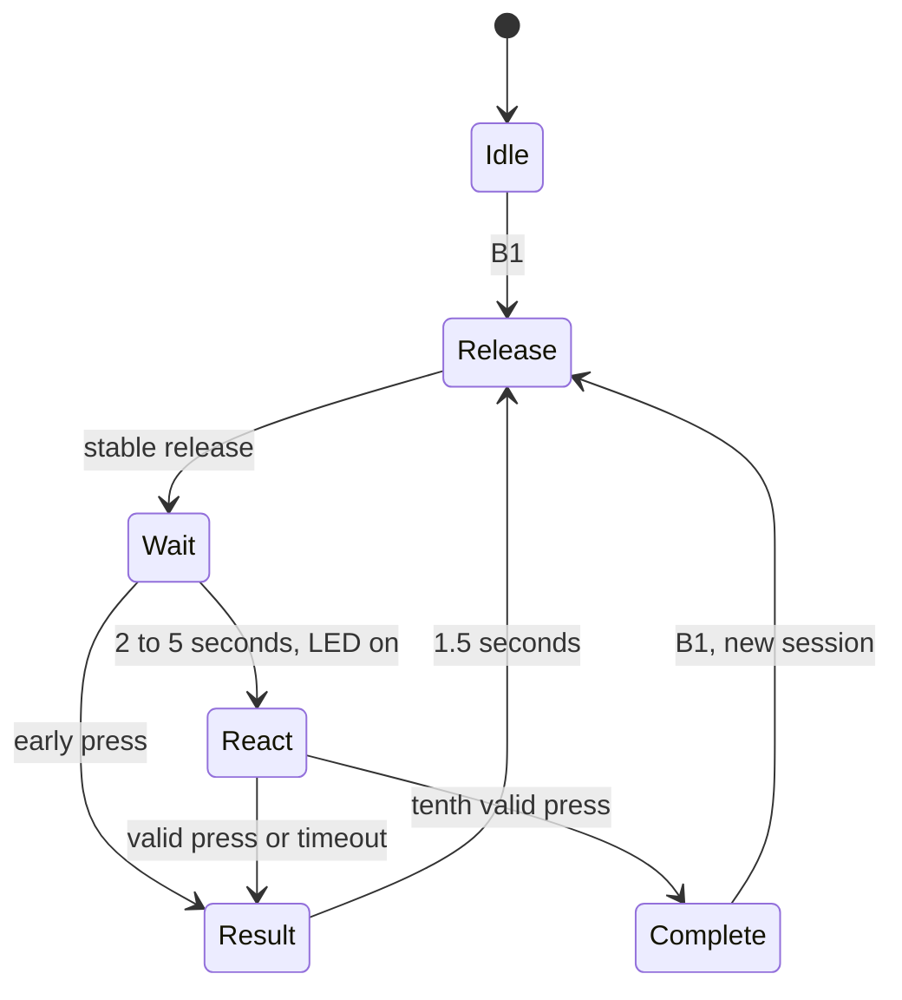

# STM32 Reflex Lab

A reaction-time game for the **NUCLEO-F446RE (MB1136)** using only its onboard
green LD2 LED, blue B1 USER button, and ST-LINK USB connection. No external sensor,
breadboard, or jumper wire is needed.

[Turkce baslangic kilavuzu](BASLANGIC.md)

## Play

1. Open the serial monitor at **115200 baud, 8N1** and press black RESET to see the banner.
2. Press and release blue **B1** to start a session.
3. Wait for green **LD2** to light, then press B1 as quickly as possible.
4. Release B1. After a short pause, the next round starts automatically.
5. After **10 valid rounds**, read your best and average time. Press B1 to restart.

Each round waits a pseudorandom 2–5 seconds before lighting LD2. An early press
or a 5-second timeout repeats the round without adding to the average. Keep the
monitor visible to distinguish waiting, false starts, and session completion.

## Build and flash in VS Code (Windows)

Open **this repository folder itself** in VS Code. No VS Code STM32
extension is required to build. The optional Microsoft C/C++ extension provides
completion and navigation.

Install STM32CubeIDE if its ARM toolchain and CubeProgrammer are not already
available. Scripts detect the executables on PATH or under `C:\ST`. For another
installation location, set `STM32_TOOLCHAIN` to the directory containing
`arm-none-eabi-gcc.exe` and `STM32_PROGRAMMER` to the full path of
`STM32_Programmer_CLI.exe`.

Use **Terminal → Run Task**:

| Task | What it does |
| --- | --- |
| `Reflex: Build` | Compile ELF and BIN into `build/`; also available with Ctrl+Shift+B |
| `Reflex: Flash` | Build, program through ST-LINK/SWD, verify, and reset the board |
| `Reflex: List Ports` | List available Windows COM ports |
| `Reflex: Monitor` | Show live scores and save a CSV into `results/` |

Connect a **data-capable USB cable to the ST-LINK connector**. Flashing replaces
the program on the board. If several ST-LINK boards are attached, disconnect the
others before using the provided flash task. Select the ST-LINK Virtual COM Port
in the monitor prompt; leaving it blank works when exactly one port is present.
Only one serial monitor can use the port at a time. Stop the monitor with Ctrl+C.

Equivalent PowerShell commands, from this folder:

```powershell
powershell -NoProfile -ExecutionPolicy Bypass -File Tools/build.ps1
powershell -NoProfile -ExecutionPolicy Bypass -File Tools/flash.ps1
powershell -NoProfile -ExecutionPolicy Bypass -File Tools/monitor.ps1 -List
powershell -NoProfile -ExecutionPolicy Bypass -File Tools/monitor.ps1 -Port COM4
```

Replace COM4 with your own port. These scripts require only Windows PowerShell
and the STM32 tools; **Python is optional**.

## Optional result chart

After recording rounds, install Python 3.10+ and plotting dependencies, then run:

```powershell
python -m pip install -r Tools/requirements.txt
python Tools/plot_results.py results/session-YOUR-TIMESTAMP.csv
python Tools/plot_results.py results/session-YOUR-TIMESTAMP.csv --save results/chart.png
```

The chart plots each session's valid reaction times in milliseconds. The data
comes from the CSV captured by the monitor, not generated demo values.

## How it works

The CPU runs at 84 MHz from the internal HSI oscillator and PLL. TIM2 is a 32-bit
free-running **1 MHz** counter. A falling edge on PC13 captures a timestamp in the
EXTI interrupt. The foreground state machine consumes the event and reports the
score, so serial output does not determine the reaction time.

The first button edge is accepted immediately. Further edges are ignored until
the button has been released continuously for 30 ms. This avoids adding a fixed
debounce delay to the measurement. LED activation and the corresponding start
timestamp are updated in a short critical section. Unsigned subtraction handles
the timer wrap at about 71.6 minutes for each short round interval.

**Resolution is 1 microsecond, not a guarantee of 1-microsecond accuracy.** HSI
clock tolerance, interrupt latency, switch mechanics, and the small interval
between the LED write and timestamp affect accuracy. This is an educational
reaction game, not a calibrated measurement instrument. Random waits use a
xorshift PRNG seeded by the user's start-button timestamp.



| File | Responsibility |
| --- | --- |
| `Core/Src/main.c` | Clock, GPIO, timer, UART, input debounce, interrupt handoff |
| `Core/Src/reflex.c` | Hardware-independent game state machine and statistics |
| `Core/Inc/reflex.h` | State and event interface |
| `Tools/` | Build, flash, monitor, tests, optional chart |
| `tests/test_reflex.c` | Host tests for game logic and timing boundaries |
| `Drivers/` | ST HAL and Arm CMSIS dependencies with vendor notices |

This is a standalone, hand-maintained HAL project, not generated from a CubeMX `.ioc` file. The Windows
scripts are the supported firmware build path; a native GCC compiler can run the
portable state-machine tests on other platforms.

## Serial protocol

Lines beginning with `#` are status messages. One result line is emitted per
valid round:

```text
RESULT,session,round,reaction_us,best_us,average_us,early,timeouts
```

The line above describes the fields; actual result lines contain integers after
`RESULT`. All time fields are microseconds. `early` and `timeouts` are cumulative
within the session. The integer average is truncated to whole microseconds.
Session IDs restart at 1 after board reset. CSV files omit the `RESULT` prefix.

## Validation

With a native host GCC installed:

```powershell
powershell -NoProfile -ExecutionPolicy Bypass -File Tools/test.ps1
```

Or on Linux/macOS with GCC:

```sh
gcc -std=c11 -Wall -Wextra -Werror -ICore/Inc Core/Src/reflex.c tests/test_reflex.c -o /tmp/test-reflex
/tmp/test-reflex
```

GitHub Actions runs those game-logic tests. They cover ten-round completion,
statistics, restart, early input, timeout boundaries, interrupt timestamps
processed late, and timer wrap. They do not simulate GPIO or verify the board.

Firmware was compiled and linked for STM32F446RE; the host game tests passed.
Basic board operation was confirmed by the project owner on NUCLEO-F446RE. The optional matplotlib chart has not been verified yet. For hardware validation, try a normal session, an early
press, holding B1, a missed signal, reset, and a second session. Confirm the CSV
contains one row per valid round, with ten rows after a completed session.

## Get the project

```sh
git clone https://github.com/yavuzserdar/stm32-reflex-lab.git
cd stm32-reflex-lab
code .
```

Build outputs and personal result recordings are excluded by `.gitignore`.

Original application code and tools use the MIT license; ST and Arm files retain
their own licenses. See [LICENSE](LICENSE) and [THIRD_PARTY_NOTICES.md](THIRD_PARTY_NOTICES.md).
